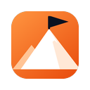
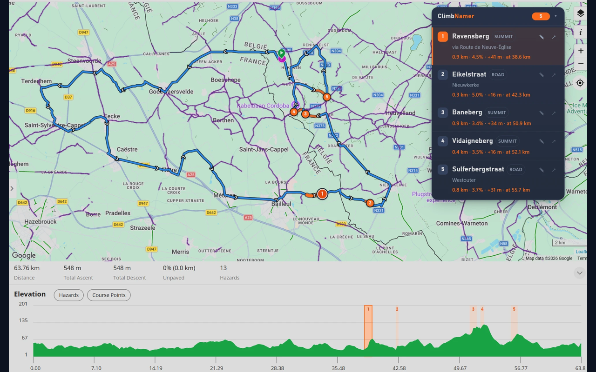

# ClimbNamer — for Garmin Connect

A Chrome / Edge extension that **finds the climbs on your Garmin Connect courses and gives
them names**. Garmin Connect shows a course's elevation profile, but doesn't tell you
where the climbs are or what they're called. ClimbNamer does: *Kemmelberg*, *Rodeberg*,
*Col du Galibier*…

**[➜ Install ClimbNamer for Garmin Connect from the Chrome Web Store](https://chromewebstore.google.com/detail/climbnamer-for-garmin-con/ejokejjhepoeeebomjahihncemjbmfda)**
(works in Google Chrome and Microsoft Edge)

> **Not affiliated with Garmin.** ClimbNamer is an independent project. It is not
> endorsed or sponsored by Garmin. Garmin, Garmin Connect and ClimbPro are trademarks of
> Garmin Ltd. or its subsidiaries.

Sister project: [ClimbNamer for Hammerhead Dashboard](https://github.com/bertpinoy/ClimbNamer).

## Features

- **Climbs detected automatically** on every course you open in Garmin Connect, with
  criteria similar to Garmin's ClimbPro.
- **ClimbNamer panel** with every climb: name, length, average grade, elevation gain
  and where the climb starts.
- **Climbs on the elevation chart:** orange bands on Garmin's own elevation profile,
  numbered like the panel. Hover a climb in the panel to highlight it on the chart.
- **Climbs on the map:** every climb is drawn in orange on Garmin's route line, with a
  numbered badge at its top.
- **Click a climb** in the panel to zoom the map to it; it's drawn stronger on the map and
  picked out on the chart. Click it again to deselect it.
- **Rename** a climb with ✎. Your name is used for that climb on every course.
- **Fast:** summit names are instant for Belgium, the Netherlands and Luxembourg, and
  for any area you looked at before; every climb is looked up only once.

## How climbs are detected

Garmin Connect doesn't list the climbs of a course, so ClimbNamer detects them from the
course's elevation profile (the points Garmin Connect itself loads for the course page):

- the profile is resampled every 20 m and smoothed over 100 m against elevation noise;
- a climb is a steady rise to a top: it starts where the slope (over 200 m) stays at
  least 2%, and ends at the top;
- a dip only ends a climb if it's at least 10 m and at least 25% of the height gained;
  climbing pieces less than 300 m apart without a real dip are one climb, as long as
  the combined climb is still steep enough;
- a climb counts if it's at least 300 m long, averages at least 3%, and
  length (m) × grade (%) ≥ 1,500 (for example 500 m at 3%).

If a course response from Garmin ever includes climbs, those are used instead. The
thresholds are at the top of [`extension/climbs.js`](extension/climbs.js).

## How names are found

All names come from [OpenStreetMap](https://www.openstreetmap.org):

1. a named **summit or pass** (`natural=peak/hill/saddle`, `mountain_pass=yes`) within
   ~600 m of the highest point of the climb;
2. otherwise the **road** the climb mostly follows (in Flanders often the climb's name
   itself: *Koppenberg*, *Paterberg*, *Oude Kwaremont*);
3. otherwise *Climb near &lt;village&gt;*.

**Instant summit names.** Summits for **Belgium, the Netherlands and Luxembourg** are
included in the extension (about 1,150). **Elsewhere**, the first time you open a course
in an area, the named summits of that area (about 55 × 50 km) are downloaded once and
kept on your device.

If a name is wrong or missing, fix it in OpenStreetMap (everyone benefits) or rename the
climb with ✎.

## Fair use of OpenStreetMap services

ClimbNamer uses free public services run by volunteers and non-profits:

- **Each climb is looked up only once;** results are cached in your browser.
- **Summits per area, not per climb:** one request for a ~55 × 50 km area, one area at a
  time, refreshed after 180 days; Benelux needs none.
- **One request at a time:** Overpass mirrors are tried one after another, and Nominatim
  gets at most 1 request per second, as its
  [usage policy](https://operations.osmfoundation.org/policies/nominatim/) requires.
- Lookups only happen for the course you open; there are no background lookups.
- Requests identify the app as `ClimbNamer/<version> (+https://github.com/bertpinoy/ClimbNamer-Garmin)`.

## Privacy

No accounts, no analytics, no server of our own. ClimbNamer reads the course data the
Garmin Connect page already loads, inside your browser. Only climb coordinates (and the
outline of the area around them) are sent to the OpenStreetMap services to find names.
See the [privacy policy](PRIVACY.md).

## Install

**Chrome:** install from the [Chrome Web Store](https://chromewebstore.google.com/detail/climbnamer-for-garmin-con/ejokejjhepoeeebomjahihncemjbmfda) and click **Add to Chrome**.
Updates are installed automatically.

**Edge:** open the same [Chrome Web Store page](https://chromewebstore.google.com/detail/climbnamer-for-garmin-con/ejokejjhepoeeebomjahihncemjbmfda) in Edge, click
**Allow extensions from other stores** when Edge asks, then **Get** / **Add to Chrome**.

**From source** (for development):

1. Download or clone this repository.
2. Open `chrome://extensions` (Chrome) or `edge://extensions` (Edge).
3. Turn on **Developer mode**.
4. Click **Load unpacked** and select the `extension` folder.
5. Open a course in <https://connect.garmin.com> (Training & Planning → Courses).

Click the ClimbNamer toolbar icon to open the settings: your custom names and the name
cache.

## Repository layout

| Path | Contents |
|---|---|
| `extension/` | The extension (Manifest V3). This folder is what gets packaged. |
| `extension/climbs.js` | Climb detection from a course's elevation profile |
| `extension/inject.js` | Runs in the page; reads the course data Garmin Connect loads (read-only) and draws the climbs on the map |
| `extension/content.js`, `content.css` | Panel, climb bands on the elevation chart, rename |
| `extension/background.js`, `naming.js` | OpenStreetMap lookups, cache, fair-use limits |
| `extension/summits.js`, `extension/data/` | Instant summit names: bundled Benelux summits and downloaded areas |
| `extension/options.*` | Settings page |
| `store/` | Store listing texts and images |
| `tools/make-summits.py` | Rebuilds the bundled Benelux summit data from OpenStreetMap |
| `tools/make-graphics.py` | Draws the icons and store promo tiles (needs Pillow) |
| `tools/package.ps1` | Builds the upload zip in `dist/` |

The naming code (`naming.js`, `summits.js`, `background.js`) is shared with
[ClimbNamer for Hammerhead Dashboard](https://github.com/bertpinoy/ClimbNamer); keep
fixes in sync.

## Releasing

1. Raise `version` in `extension/manifest.json`.
2. Run `powershell -File tools/package.ps1`. This creates `dist/ClimbNamer-Garmin-<version>.zip`.
3. Upload the zip in the Chrome Web Store Developer Dashboard (item `ejokejjhepoeeebomjahihncemjbmfda`,
   **Package → Upload new package**). The listing texts are in
   [`store/listing.md`](store/listing.md).

If Garmin changes Garmin Connect, the parts most likely to need an update are the API
URL patterns and the map lookup (`findMap`) in `extension/inject.js`, and the Recharts
selectors in `extension/content.js` (`findChart`, `xTicks`).

## License

Copyright 2026 bertpinoy. The code is licensed under the [Apache License 2.0](LICENSE).
Map data is not covered by this license; see below.

Map data © [OpenStreetMap contributors](https://www.openstreetmap.org/copyright), ODbL. See [DATA-LICENSE.md](DATA-LICENSE.md).
